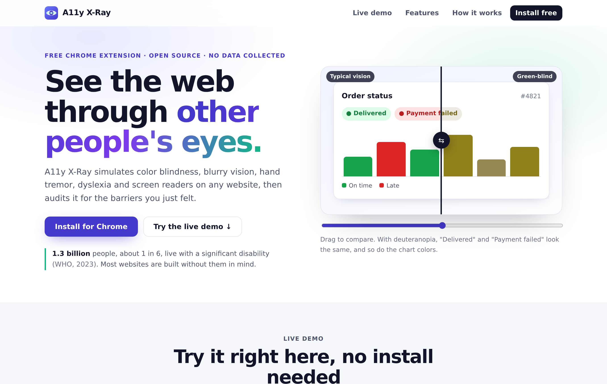
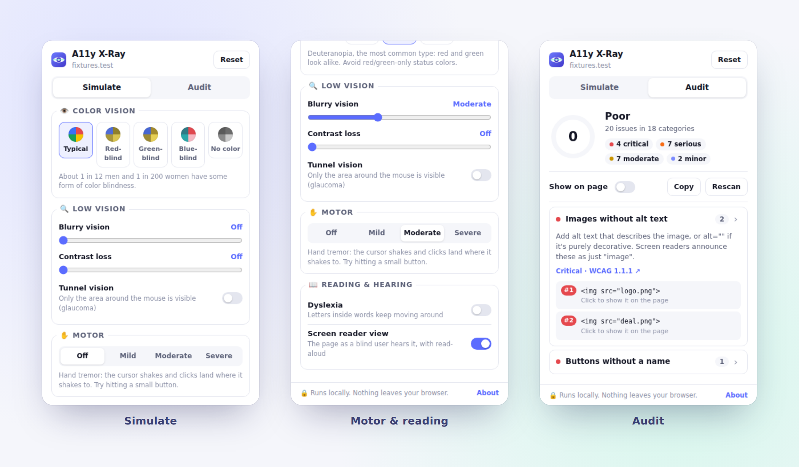
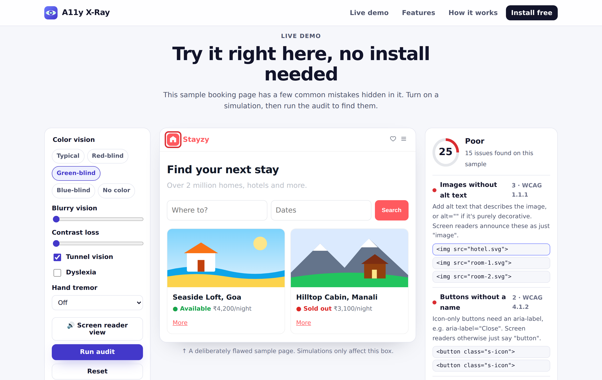
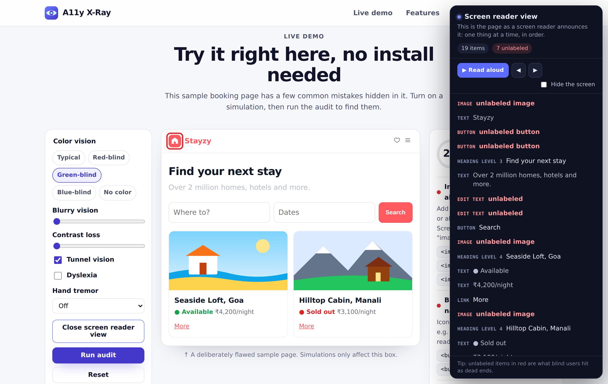

<p align="center">
  
</p>

<h1 align="center">A11y X-Ray</h1>

<p align="center">
  <b>See the web through other people's eyes.</b><br>
  A free Chrome extension that lets you <i>feel</i> what it's like to use a website with a disability, then audits the page for the barriers you just felt.
</p>

<p align="center">
  <a href="https://mudit2308.github.io/a11y-xray/"><b>Live demo</b></a> ·
  <a href="#install">Install</a> ·
  <a href="#how-it-works">How it works</a> ·
  <a href="PRIVACY.md">Privacy</a>
</p>

<p align="center">
  <a href="https://github.com/mudit2308/a11y-xray/actions/workflows/ci.yml"></a>
  
  
  
  
</p>



## Why

About **1.3 billion people** (1 in 6) live with a significant disability (WHO, 2023). Most developers have never seen their own site the way a color-blind, low-vision, motor-impaired or blind user does. Accessibility checkers give you a list of errors; A11y X-Ray lets you **experience the problem first**, so the fix actually makes sense.

## Features

### Simulate

| Simulation | What you experience |
| --- | --- |
| **Color blindness** | Protanopia (red-blind), deuteranopia (green-blind), tritanopia (blue-blind) and achromatopsia (no color), using the Machado et al. (2009) model |
| **Blurry vision** | Adjustable blur, like uncorrected low vision |
| **Contrast loss** | Washed-out colors, like cataracts or a phone in sunlight |
| **Tunnel vision** | Only a small circle around your mouse is visible, like advanced glaucoma |
| **Hand tremor** | The cursor shakes, and clicks land where it shakes to. Try hitting a small button. |
| **Dyslexia** | Letters inside words keep shifting while you read |
| **Screen reader view** | The page as a blind user hears it: one item at a time, in order, with real read-aloud and a "hide the screen" mode |

### Audit

One click scans the page against **19 WCAG 2.2 checks** and gives it a score out of 100:

- Images without alt text, buttons and links without a name, form fields without labels
- Text contrast (real WCAG ratio, including the background behind the text)
- Missing page language or title, iframes without titles, pinch-zoom disabled
- Heading order, missing or empty headings, no `main` landmark
- Touch targets smaller than 24×24 px (with the WCAG 2.5.8 spacing exception)
- Vague link text ("click here", "more"), positive `tabindex`, autoplaying media, duplicate IDs, placeholder-only labels

Every issue tells you **why it matters**, **how to fix it**, and links to the official WCAG explanation. Click an issue to jump to it on the page with a highlight, toggle **Show on page** to see every problem at once, or **Copy** a Markdown report for a bug ticket.



## Try it without installing

The [live demo](https://mudit2308.github.io/a11y-xray/#demo) runs the same engine on a deliberately flawed sample booking site. Turn on a simulation, run the audit, and open the screen reader view right in the page.





## Install

Works in Chrome, Edge, Brave and other Chromium browsers (version 102+).

1. [Download the ZIP](https://github.com/mudit2308/a11y-xray/archive/refs/heads/main.zip) and unzip it.
2. Open `chrome://extensions` and turn on **Developer mode** (top right).
3. Click **Load unpacked** and select the `extension` folder.
4. Pin **A11y X-Ray** from the 🧩 menu, open any website and click the icon.

## How it works

```
extension/
├── manifest.json        Manifest V3: activeTab + scripting + storage, no host permissions
├── popup/               The toolbar popup (Simulate / Audit tabs)
└── content/             Injected into the current tab only when you click the icon
    ├── color.js         Color parsing, WCAG luminance + contrast, CVD matrices
    ├── audit.js         19 WCAG rules, accessible-name computation, scoring
    ├── simulate.js      Vision, motor and reading simulations (all reversible)
    ├── reader.js        Screen reader reading order + panel (shadow DOM)
    └── xray.js          Glue: state, highlights, serializable audit results
```

- **Color blindness** uses SVG `feColorMatrix` filters with the Machado 2009 matrices in linear RGB, the same model used by Chrome DevTools. On real pages the filter is applied as a `backdrop-filter` on a transparent overlay, so the extension's own UI stays sharp on top.
- **Contrast** is checked with the WCAG relative-luminance formula. Semi-transparent text and backgrounds are blended down to the real colors the user sees before the ratio is computed.
- **Screen reader view** walks the DOM in reading order and computes each element's accessible name (`aria-labelledby`, `aria-label`, `alt`, `<label>`, `title`, text content), the same way assistive technology does.
- **Hand tremor** hides the real cursor, draws a shaking one, and re-targets your clicks with `elementFromPoint` at the shaken position.
- **The score** is 100 minus a weighted penalty per rule (critical 10, serious 6, moderate 3, minor 1), scaled logarithmically by how many times each rule fails.
- **Zero dependencies.** Plain JavaScript, no build step, no framework. The landing page loads the exact same content scripts as the extension.

## Privacy

A11y X-Ray has **no server, no analytics and no tracking**. It only runs on a tab when you click its icon (`activeTab`), and audit results stay in your browser's session storage. See [PRIVACY.md](PRIVACY.md).

## Development

```bash
git clone https://github.com/mudit2308/a11y-xray.git
cd a11y-xray
npm install
npm start           # landing page + live demo at http://localhost:3000
npm test            # unit tests: contrast math, color parsing, CVD simulation
npm run test:e2e    # Playwright: runs every rule against good and bad fixture pages
npm run zip         # packages the extension into a11y-xray.zip
```

Every push runs both test suites on GitHub Actions.

## Limits

Automated checks catch a lot, but not everything. Studies estimate tools find roughly a third to half of real accessibility issues. A11y X-Ray is a learning and empathy tool. Always test with keyboard-only navigation, a real screen reader, and, most importantly, real people.

## License

[MIT](LICENSE) © 2026 [Mudit Pathak](https://github.com/mudit2308)
